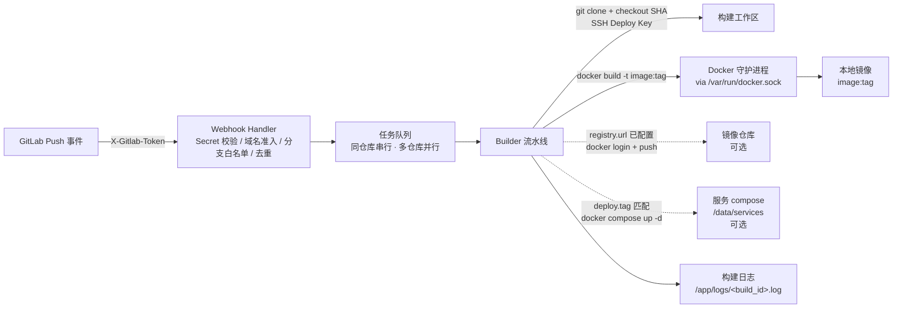

# gitlab-builder

GitLab Webhook 触发的**通用 Docker 镜像自动构建服务**。任何挂在授权 GitLab 域名下的项目，把 Webhook 指向本服务，Push 即自动产出本地镜像；不推送任何 Registry。

## 特性

- **无需登记仓库**：配置只有 `server`、`code` 与可选的 `build` / `registry` / `deploy`，不维护仓库列表；唯一准入条件是事件中的仓库地址属于 `code.domain`
- **默认仅本地构建，可选推送**：不配置 `registry.url` 时镜像只留在构建机；配置后构建成功自动打远程 tag 并 push（`docker login` + `docker push`）
- **标签可配置**：默认标签 = Commit SHA 前 8 位；`build.tag` 设全局固定标签、`build.branch_tags` 按分支覆盖（如 `pre: latest`、`main: stable`）
- **构建后自动发布（可选）**：配置 `deploy` 后，当某次构建产出的标签等于 `deploy.tag`（默认 `latest`）时，对目标服务执行 `docker compose up -d`，直接使用刚构建出的本地镜像（不 pull）；发布失败不影响构建结果（构建仍成功，错误记入 `deploy_err`）
- **流水线通知（可选）**：配置 `notify.lark.webhook_url` 后，向飞书群机器人推送流水线开始 / 成功 / 失败卡片，字段与 Jenkins 共享库一致（项目名称、构建发起、当前版本 `分支-短SHA`、持续时间、提交摘要、错误摘要、推送时间）；部署失败会在成功卡片中追加提示；通知失败不影响构建（记入 `NotifyError`）
- **Docker Socket 构建**：服务容器通过挂载 `/var/run/docker.sock` 调用宿主机 `docker build`
- **SSH Deploy Key**：一把全局只读 Deploy Key（经 `GITLAB_DEPLOY_KEY_PATH` 环境变量注入）拉取该 GitLab 实例下所有被触发仓库
- **分支白名单**：`code.branches` 精确匹配（默认 `main`、`master`）
- **Commit SHA 精确构建**：按 webhook 推送的 `checkout_sha` 精确 checkout（校验 40/64 位十六进制）；标签默认 = SHA 前 8 位，可经 `build.tag` / `build.branch_tags` 改为固定标签
- **任务队列**：全局并发可配；**同一仓库（按归一化 URL）串行、不同仓库并行**
- **重复投递去重**：同一仓库的同一 Commit 在排队/构建期间不会重复入队，重发返回 `duplicate`
- **Webhook Secret 校验**：`X-Gitlab-Token` 恒定时比较，常数时间防时序攻击
- **仓库自带 Dockerfile 优先，内置模板兜底**：有 `Dockerfile` 就用（绝不覆盖）；没有时按语言标记（Go / Node / Vue / Java / Gradle / Python / PHP）套用内置模板并调用内置构建脚本（`build-go` / `build-maven` / `build-node` / `build-python` / `build-php`），两类都没有才明确报错
- **构建日志**：每次构建的完整 git + docker 输出落盘，可经 API 查询；URL 凭据全程脱敏
- **防泄漏与超时**：SSH 主机密钥 `accept-new`（首次 TOFU、之后拒绝变更）；clone 15 分钟 / docker build 25 分钟 / 单任务 30 分钟超时兜底

## 架构



## 快速开始

```bash
# 1. 准备 Deploy Key（一把全局只读 key，添加到所有被构建项目）
mkdir -p secrets && chmod 700 secrets
ssh-keygen -t ed25519 -f ./secrets/gitlab_deploy_key -N ""
# 公钥添加到 GitLab 各项目：Settings → Repository → Deploy Keys（勾选 Read-only）

# 2. 配置
#    编辑 config/config.yaml：code.domain 填仓库所在域名（如 code.zmatrix.cn），
#    其余为 server 运行参数（各字段有中文注释）
export GITLAB_WEBHOOK_SECRET="$(openssl rand -hex 32)"
export GITLAB_DEPLOY_KEY_PATH="/run/secrets/gitlab_deploy_key"   # 可选

# 3. 启动
docker compose up -d

# 4. 在 GitLab 项目 Webhook 中指向本服务（详见 docs/GITLAB.md）
#    URL:  http://<构建机IP>:8080/webhook
#    Secret token: 与 GITLAB_WEBHOOK_SECRET 相同
#    触发器: 勾选 Push events

# 5. 验证
curl http://<构建机IP>:8080/api/builds
```

## 环境变量

| 变量 | 必填 | 说明 |
|---|---|---|
| `GITLAB_WEBHOOK_SECRET` | 是 | Webhook Secret，与 GitLab 侧一致；未设置时启动失败 |
| `GITLAB_DEPLOY_KEY_PATH` | 否 | 全局 SSH Deploy Key 私钥路径（容器内路径）；设置但文件不可读则启动失败 |
| `REGISTRY_PASSWORD` | 否 | 供 `registry.password` 用 `${...}` 引用的镜像仓库密码；仅当配置了推送时需要 |
| `LOG_LEVEL` | 否 | `debug` / `info`（默认）/ `warn` / `error` |

## API

| 方法 | 路径 | 说明 |
|---|---|---|
| POST | `/webhook` | GitLab Push 事件入口（校验 `X-Gitlab-Token`） |
| GET | `/api/builds` | 构建列表（最新在前） |
| GET | `/api/builds/:id` | 单个构建详情（状态、镜像标签、错误信息） |
| GET | `/api/builds/:id/log` | 完整构建日志（text/plain） |
| GET | `/healthz` | 健康检查 |

Webhook 响应状态：

| 状态码 | 含义 |
|---|---|
| 202 `{"status":"queued","build_id":...,"image":...,"tag":...}` | 已入队 |
| 202 `{"status":"ignored","reason":...}` | 非 Push / 删除事件 / 非分支 ref / Commit SHA 非法 |
| 202 `{"status":"host_not_allowed"}` | 事件仓库地址域名不等于 `code.domain` |
| 202 `{"status":"missing_repo_url"}` | 事件缺少仓库地址字段（异常 payload） |
| 202 `{"status":"branch_filtered"}` | 分支不在 `code.branches` 白名单 |
| 202 `{"status":"duplicate","build_id":...}` | 同仓库同 Commit 已在排队/构建中，未重复入队 |
| 401 | Secret 校验失败 |
| 400 | 请求体非法或过大 |
| 503 `{"error":"queue_full"}` | 任务队列已满 |

## 镜像标签规则

- **镜像名** = 仓库名（事件 `project.name`，转小写并规整为 Docker 合法字符 `[a-z0-9._-]`；URL 末段兜底）。不同仓库撞名时追加 `-<哈希8位>` 稳定后缀，不同项目绝不共享同一镜像名。
- **标签**解析顺序：`build.branch_tags[分支]` → `build.tag` → Commit SHA 前 8 位。三者都未配置时保持旧的 SHA 前 8 位行为（不附加分支名）。标签必须是合法 Docker tag（`^[A-Za-z0-9_][A-Za-z0-9_.-]{0,127}$`）。
- **推送**（仅当 `registry.url` 非空）= 在本地 tag 之外再打一个远程 tag `<url>[/<project>]/<镜像名>:<tag>` 并 `docker push`。
- **发布**（仅当 `deploy.enabled` 且产出的 tag 等于 `deploy.tag`）= 在 `/data/services/<服务名>/<compose 文件>` 执行 `docker compose -p <项目名> up -d <服务名>`。

推送 `main` 分支、commit `a1b2c3d4e5f6...`、项目 `Backend-API` 时：

```
# 未配置 build.tag / branch_tags（默认）：
backend-api:a1b2c3d4                              # 本地（始终）
registry.example.com/tenants/backend-api:a1b2c3d4 # 远程（配置 registry.url 后）

# 配置 build.branch_tags: {main: stable} 后：
backend-api:stable                                # 本地（始终）
registry.example.com/tenants/backend-api:stable   # 远程（配置 registry.url 后）
```

## 配置

配置文件有 `server`、`code` 两段与可选的 `build` / `registry` / `deploy` / `notify` 段，全部字段与中文注释见 [`config/config.yaml`](config/config.yaml)：

```yaml
server:
  listen: ":8080"
  workspace: "/app/workspace"
  logs_dir: "/app/logs"
  queue_size: 10
  concurrency: 2

code:
  webhook_secret: "${GITLAB_WEBHOOK_SECRET}"
  domain: "code.gitlab.com"
  branches: ["main", "master"]

# 可选；省略 = 标签默认取 Commit SHA 前 8 位
build:
  tag: ""                      # 全局默认标签，例: latest
  branch_tags: {}              # 按分支覆盖，例: {main: stable, pre: latest}

# 可选；省略或不填 url = 仅本地构建（默认）
registry:
  url: ""            # 填了才推送，例: registry.example.com
  project: ""        # 可选镜像名前缀，例: tenants
  username: ""       # 与 password 成对出现；都填则推送前 docker login
  password: ""       # 建议用 ${REGISTRY_PASSWORD} 环境变量注入

# 可选；省略或 enabled:false = 不自动发布
deploy:
  enabled: false
  services_dir: "/data/services"     # 每服务一个子目录；需同路径挂载进容器
  compose_file: "docker-compose.yaml" # 该目录内 compose 文件名（缺失时自动找 compose.yaml 等）
  project_name: ""                    # 留空 = 服务目录名
  tag: "latest"                       # 仅当产出标签等于它时发布
  wait: false                         # up -d 后是否等待健康（--wait --wait-timeout）
  wait_timeout: "120s"
  # services:                         # 可选：按服务名覆盖路径/服务键/项目名/compose 文件名
  #   ex-backend: {dir: ex-backend, service: ex-backend}

# 可选；省略或 enabled:false = 不发送通知
notify:
  enabled: false
  on_started: true                   # 🚀 流水线开始
  on_success: true                   # ✅ 流水线成功（含“部署失败”提示）
  on_failure: true                   # ❌ 流水线失败
  lark:
    webhook_url: ""                  # 飞书机器人 Webhook（直接写配置；敏感，不落日志）
    secret: ""                       # 可选：签名校验密钥
    timeout: "10s"                   # 单次投递超时
```

## 构建文件选择

构建上下文始终是仓库根目录。构建方式按以下顺序确定：

1. **仓库自带 Dockerfile**：仓库根目录存在 `Dockerfile` 时直接使用，绝不覆盖、绝不替换（也不会写入任何脚本）；
2. **内置模板 + 构建脚本兜底**：没有 `Dockerfile` 时，按仓库根目录的语言标记自动选择内置多阶段模板，并把模板要用的构建脚本写入仓库根的 `.gitlab-builder/build.sh`，随后 `docker build`：

| 模板 | 触发标记 | 调用的脚本 | 产物 → 运行方式 |
|---|---|---|---|
| `go` | `go.mod` | `build-go.sh 0` | `go mod tidy` + `go build -o app .`（**根包**）→ 静态产物进 `scratch` |
| `java` | `pom.xml` | `build-maven.sh 21` | `mvn clean package -DskipTests` → `app.jar` → JRE 21 |
| `gradle` | `build.gradle` / `build.gradle.kts` | 无脚本 | `gradle bootJar`（否则 `build`）→ JRE 21 |
| `vue` | `package.json`（含 `vue` / `nuxt` / `@vue/*` 依赖） | `build-node.sh lts npm` | Node 构建产物 → nginx 托管 |
| `node` | `package.json`（无 Vue 依赖） | `build-node.sh lts npm` | Node 构建 → 非 root 运行，入口 `dist/index.js` |
| `python` | `requirements.txt` / `Pipfile` / `pyproject.toml` | `build-python.sh` | 依赖装入运行镜像 → `python main.py`（根目录 `main.py`） |
| `php` | `composer.json` | `build-php.sh` | `composer install --no-dev` → PHP 内置服务器托管 `public/`（:8000） |

3. **两者都没有**：既无 `Dockerfile` 也无识别到的语言标记时，构建以 `no Dockerfile at repository root and no built-in template matched` 明确失败（不猜测、不生成空模板）。

### 内置构建脚本

脚本内嵌在服务二进制中（源码 `internal/templates/scripts/`），按所选模板写入 `.gitlab-builder/build.sh` 供构建阶段调用：

- **`build-go.sh <cgo-enabled>`**：`go mod tidy` 后 `GOOS=linux GOARCH=amd64 CGO_ENABLED=$1 go build -buildvcs=false -o app -trimpath .`（构建**根包**，产物 `app`）。
- **`build-maven.sh <java-version>`**：有 SDKMAN 则用其切换 Java/Maven（否则 WARN 降级用系统工具）；`mvn clean package -DskipTests` 后取**主 jar**（跳过 `-sources` / `-javadoc` / `-plain`）复制为 `app.jar`。
- **`build-node.sh <node-version> <package-manager>`**：有 Volta 则用其切换 Node（否则 WARN 降级用系统 Node）；按 `npm` / `pnpm` / `yarn` 安装依赖并执行项目 `build`。
- **`build-python.sh`**：优先 `requirements.txt`（`pip install -r`），其次 `Pipfile`（`pipenv install --system`），再次 `pyproject.toml`（`pip install .`）；与 Jenkins 共享库 `PythonBuilder` 语义一致。
- **`build-php.sh`**：存在 `composer.json` 时执行 `composer install --no-dev --optimize-autoloader`；与 Jenkins 共享库 `PhpBuilder` 语义一致。

参数由模板写死为约定默认值（`cgo=0`、`java=21`、`node=lts`、`pm=npm`；Python / PHP 无参数）。脚本对 SDKMAN / Volta **优雅降级**：官方镜像里没有版本管理器时自动改用镜像自带工具链。

注意：

- 约定入口/产物（Go 根包 `app`、Node 入口 `dist/index.js`、Python 入口根目录 `main.py`、PHP 入口 `public/`）不符时，请在仓库根目录提供自己的 `Dockerfile` 覆盖模板；
- `.gitlab-builder/` 属构建上下文，**请勿**在仓库 `.dockerignore` 中排除；
- 每次构建日志会写明来源与路径：`==> dockerfile source=repository|template:<name> path=...`；
- 配置 `registry.url` 后，构建成功会打印 `==> registry push enabled remote=...` 并执行 `docker login` + `docker push`；推送失败即构建失败（镜像已本地保留）。

## 文档

- [部署文档](docs/DEPLOY.md) — 目录结构、权限、安全、排障
- [GitLab 配置步骤](docs/GITLAB.md) — Webhook / Deploy Key 逐步指引
