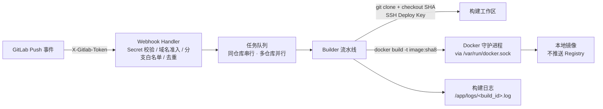

# gitlab-builder

GitLab Webhook 触发的**通用 Docker 镜像自动构建服务**。任何挂在授权 GitLab 域名下的项目，把 Webhook 指向本服务，Push 即自动产出本地镜像；不推送任何 Registry。

## 特性

- **无需登记仓库**：配置只有 `server` 与 `code` 两段，不维护仓库列表；唯一准入条件是事件中的仓库地址属于 `code.domain`
- **仅本地构建**：镜像只存在于构建机的 Docker 守护进程中，不 push
- **Docker Socket 构建**：服务容器通过挂载 `/var/run/docker.sock` 调用宿主机 `docker build`
- **SSH Deploy Key**：一把全局只读 Deploy Key（经 `GITLAB_DEPLOY_KEY_PATH` 环境变量注入）拉取该 GitLab 实例下所有被触发仓库
- **分支白名单**：`code.branches` 精确匹配（默认 `main`、`master`）
- **Commit SHA 精确构建**：按 webhook 推送的 `checkout_sha` 精确 checkout（校验 40/64 位十六进制），标签 = SHA 前 8 位
- **任务队列**：全局并发可配；**同一仓库（按归一化 URL）串行、不同仓库并行**
- **重复投递去重**：同一仓库的同一 Commit 在排队/构建期间不会重复入队，重发返回 `duplicate`
- **Webhook Secret 校验**：`X-Gitlab-Token` 恒定时比较，常数时间防时序攻击
- **仓库自带 Dockerfile**：只使用仓库根目录的 `Dockerfile`，不生成、不切换模板；缺失即明确报错
- **构建日志**：每次构建的完整 git + docker 输出落盘，可经 API 查询；URL 凭据全程脱敏
- **防泄漏与超时**：SSH 主机密钥 `accept-new`（首次 TOFU、之后拒绝变更）；clone 15 分钟 / docker build 25 分钟 / 单任务 30 分钟超时兜底

## 架构



## 快速开始

```bash
# 1. 准备 Deploy Key（一把全局只读 key，添加到所有被构建项目）
mkdir -p secrets && chmod 700 secrets
ssh-keygen -t ed25519 -f ./secrets/gitlab_deploy_key -N ""
# 公钥添加到 GitLab 各项目：Settings → Repository → Deploy Keys（勾选 Read-only）

# 2. 配置
#    编辑 config/config.yaml：code.domain 填仓库所在域名（如 code.zmatrix.cn），
#    其余为 server 运行参数（各字段有中文注释）
export GITLAB_WEBHOOK_SECRET="$(openssl rand -hex 32)"
export GITLAB_DEPLOY_KEY_PATH="/run/secrets/gitlab_deploy_key"   # 可选

# 3. 启动
docker compose up -d

# 4. 在 GitLab 项目 Webhook 中指向本服务（详见 docs/GITLAB.md）
#    URL:  http://<构建机IP>:8080/webhook
#    Secret token: 与 GITLAB_WEBHOOK_SECRET 相同
#    触发器: 勾选 Push events

# 5. 验证
curl http://<构建机IP>:8080/api/builds
```

## 环境变量

| 变量 | 必填 | 说明 |
|---|---|---|
| `GITLAB_WEBHOOK_SECRET` | 是 | Webhook Secret，与 GitLab 侧一致；未设置时启动失败 |
| `GITLAB_DEPLOY_KEY_PATH` | 否 | 全局 SSH Deploy Key 私钥路径（容器内路径）；设置但文件不可读则启动失败 |
| `LOG_LEVEL` | 否 | `debug` / `info`（默认）/ `warn` / `error` |

## API

| 方法 | 路径 | 说明 |
|---|---|---|
| POST | `/webhook` | GitLab Push 事件入口（校验 `X-Gitlab-Token`） |
| GET | `/api/builds` | 构建列表（最新在前） |
| GET | `/api/builds/:id` | 单个构建详情（状态、镜像标签、错误信息） |
| GET | `/api/builds/:id/log` | 完整构建日志（text/plain） |
| GET | `/healthz` | 健康检查 |

Webhook 响应状态：

| 状态码 | 含义 |
|---|---|
| 202 `{"status":"queued","build_id":...,"image":...,"tag":...}` | 已入队 |
| 202 `{"status":"ignored","reason":...}` | 非 Push / 删除事件 / 非分支 ref / Commit SHA 非法 |
| 202 `{"status":"host_not_allowed"}` | 事件仓库地址域名不等于 `code.domain` |
| 202 `{"status":"missing_repo_url"}` | 事件缺少仓库地址字段（异常 payload） |
| 202 `{"status":"branch_filtered"}` | 分支不在 `code.branches` 白名单 |
| 202 `{"status":"duplicate","build_id":...}` | 同仓库同 Commit 已在排队/构建中，未重复入队 |
| 401 | Secret 校验失败 |
| 400 | 请求体非法或过大 |
| 503 `{"error":"queue_full"}` | 任务队列已满 |

## 镜像标签规则

- **镜像名** = 仓库名（事件 `project.name`，转小写并规整为 Docker 合法字符 `[a-z0-9._-]`；URL 末段兜底）。不同仓库撞名时追加 `-<哈希8位>` 稳定后缀，不同项目绝不共享同一镜像名。
- **标签** = Commit SHA 前 8 位，不附加分支名，不生成 `latest`。

推送 `main` 分支、commit `a1b2c3d4e5f6...`、项目 `Backend-API` 时：

```
backend-api:a1b2c3d4
```

## 配置

配置文件只有 `server` 与 `code` 两段，全部字段与中文注释见 [`config/config.yaml`](config/config.yaml)：

```yaml
server:
  listen: ":8080"
  workspace: "/app/workspace"
  logs_dir: "/app/logs"
  queue_size: 10
  concurrency: 2

code:
  webhook_secret: "${GITLAB_WEBHOOK_SECRET}"
  domain: "code.gitlab.com"
  branches: ["main", "master"]
```

## Dockerfile 要求

每个被构建的仓库**必须**在仓库根目录提供自己的 `Dockerfile`（构建上下文即仓库根）。服务不生成 Dockerfile、不按语言切换模板；缺失时构建以 `no Dockerfile at repository root` 明确失败。

## 文档

- [部署文档](docs/DEPLOY.md) — 目录结构、权限、安全、排障
- [GitLab 配置步骤](docs/GITLAB.md) — Webhook / Deploy Key 逐步指引
