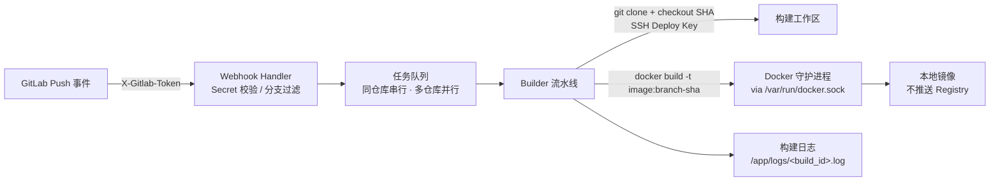

# gitlab-builder

GitLab Webhook 触发的**本地 Docker 镜像自动构建服务**。Push 代码即在构建机上产出镜像，不推送任何 Registry。

## 特性

- **无需登记仓库**：配置只需 GitLab 域名（`gitlab.host`），任何挂在该域名下的项目把 Webhook 指向本服务，Push 即触发；仓库地址、分支、Commit 全部取自事件数据
- **仅本地构建**：镜像只存在于构建机的 Docker 守护进程中，不 push
- **Docker Socket 构建**：服务容器通过挂载 `/var/run/docker.sock` 调用宿主机 `docker build`
- **SSH Deploy Key**：一把全局只读 Deploy Key 拉取该 GitLab 实例下所有被触发仓库
- **双重分支过滤**：全局正则门槛（`build.branch_regex`）+ 分支白名单（`build.branches`，支持 `release/*` 通配）
- **Commit SHA 精确构建**：按 webhook 推送的 `checkout_sha` 精确 checkout，标签含短 SHA
- **任务队列**：全局并发可配；**同一仓库串行、不同仓库并行**
- **Webhook Secret 校验**：`X-Gitlab-Token` 恒定时比较，常数时间防时序攻击
- **内置 Dockerfile 模板**：Go / Node / Vue / Java 四种多阶段构建模板，仓库无 Dockerfile 也能构建
- **构建日志**：每次构建的完整 git + docker 输出落盘，可经 API 查询
- **镜像标签规则**：`{image}:{分支名（/ 换成 -）}-{commit 短 SHA}`，可选附加 `:latest`

## 架构



## 快速开始

```bash
# 1. 准备 Deploy Key（一把全局只读 key，添加到所有被构建项目）
mkdir -p secrets && chmod 700 secrets
ssh-keygen -t ed25519 -f ./secrets/gitlab_deploy_key -N ""
# 公钥添加到 GitLab 各项目：Settings → Repository → Deploy Keys（勾选 Read-only）

# 2. 配置
#    编辑 config/config.yaml：gitlab.host 填仓库所在域名（如 code.zmatrix.cn），
#    其余为全局 build 配置（各字段有中文注释）
export GITLAB_WEBHOOK_SECRET="$(openssl rand -hex 32)"

# 3. 启动
docker compose up -d

# 4. 在 GitLab 项目 Webhook 中指向本服务（详见 docs/GITLAB.md）
#    URL:  http://<构建机IP>:8080/webhook
#    Secret token: 与 GITLAB_WEBHOOK_SECRET 相同
#    触发器: 勾选 Push events

# 5. 验证
curl http://<构建机IP>:8080/api/builds
```

## API

| 方法 | 路径 | 说明 |
|---|---|---|
| POST | `/webhook` | GitLab Push 事件入口（校验 `X-Gitlab-Token`） |
| GET | `/api/builds` | 构建列表（最新在前） |
| GET | `/api/builds/:id` | 单个构建详情（状态、镜像标签、错误信息） |
| GET | `/api/builds/:id/log` | 完整构建日志（text/plain） |
| GET | `/healthz` | 健康检查 |

Webhook 响应状态：

| 状态码 | 含义 |
|---|---|
| 202 `{"status":"queued","build_id":...}` | 已入队 |
| 202 `{"status":"ignored"}` | 非 Push / 删除事件 / 非分支 ref |
| 202 `{"status":"host_not_allowed"}` | 事件仓库地址不属于 `gitlab.host` 域名 |
| 202 `{"status":"missing_repo_url"}` | 事件缺少仓库地址字段（异常 payload） |
| 202 `{"status":"branch_filtered"}` | 分支未通过正则或白名单 |
| 401 | Secret 校验失败 |
| 400 | 请求体非法或过大 |
| 503 | 任务队列已满 |

## 镜像标签规则

镜像名 = 项目路径（`path_with_namespace`，可加 `build.image_prefix` 前缀）。
推送 `main` 分支、commit `abcdef1234567890...`、项目 `jmatrix/atlas-backend-api` 时：

```
jmatrix/atlas-backend-api:main-abcdef123456
jmatrix/atlas-backend-api:latest    # 仅当 build.tag_latest: true
```

分支 `release/1.2` → `jmatrix/atlas-backend-api:release-1.2-<短SHA>`（`/` 自动转 `-`）。

## 配置

全部字段见 [`config/config.yaml`](config/config.yaml) 内中文注释。

## 内置 Dockerfile 模板

| 模板 | 适用 | 说明 |
|---|---|---|
| `go.Dockerfile` | Go 多命令项目 | 静态编译到 scratch 基础镜像 |
| `node.Dockerfile` | Node.js 服务 | `npm ci && npm run build`，非 root 运行 |
| `vue.Dockerfile` | Vue / Vite 前端 | 构建产物交给 nginx 托管 |
| `java.Dockerfile` | Maven + JDK 21 | `mvn package`，JRE 运行时 |

默认 `build.dockerfile: auto`：仓库根目录自有 `Dockerfile` 时直接使用，否则按语言标记自动选模板（`go.mod`→Go、`pom.xml`/`build.gradle`→Java、`package.json`→Node，声明了 `vue` 依赖→Vue）；也可全局指定模板名或仓库内路径强制覆盖。

## 文档

- [部署文档](docs/DEPLOY.md) — 目录结构、权限、安全、排障
- [GitLab 配置步骤](docs/GITLAB.md) — Webhook / Deploy Key 逐步指引
